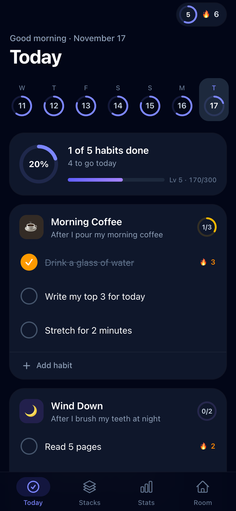
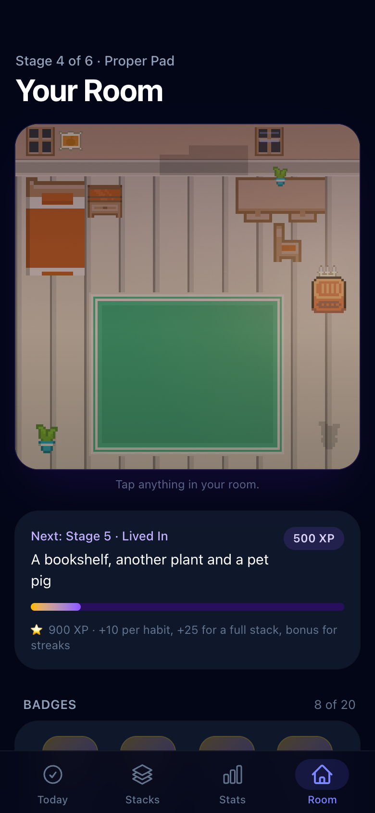
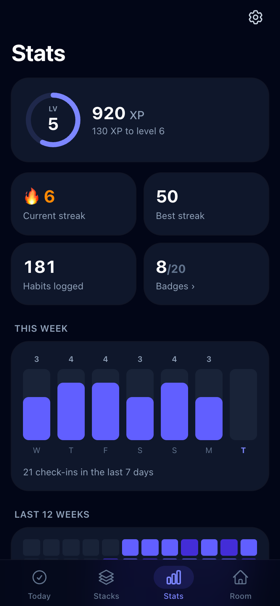

# Stackr

> Tiny habits, stacked on routines you already have — and a cozy pixel room that fills up as you go.

<p>
  
  
  
</p>

## What is it?

Stackr is an installable, offline-first habit tracker built on **habit stacking**: instead of
scheduling a habit for a time ("meditate at 7 AM"), you attach it to something you already do
("after I pour my coffee, I'll stretch for two minutes").

A **stack** is a trigger plus a few tiny habits. Check them off each day to earn XP, keep streaks
alive, unlock badges, and furnish your room.

## Features

- **Today** — a week strip with per-day progress rings, a daily summary, one-tap check-offs with
  haptics, and backfill for the past 6 days.
- **Stacks** — create from a template or from scratch; edit, reorder and delete stacks and habits
  from bottom sheets. Each stack shows a 30-day completion rate and per-habit week dots.
- **Stats** — level and XP, current/best streak, a weekly bar chart, a 12-week heatmap and
  per-habit completion rates.
- **Room** — a lofi pixel-art room that gains furniture across 6 stages. Tap any piece to see what
  it is; the next stage's pieces show as silhouettes. Day/night lighting, rain at night, and a
  sleepy mood after 3 idle days.
- **Badges** — 20 badges for streaks, totals, levels, stacks and time of day, with progress.
- **Backups** — export/restore a JSON backup and erase all data (Stats → ⚙︎).
- **PWA** — installs to the home screen, works offline, respects safe areas and reduced motion.

## Getting started

Requires Node.js 20+.

```bash
git clone https://github.com/ycdevprojects/stacks.git
cd stacks
npm install
npm run dev
```

| Command | What it does |
| --- | --- |
| `npm run dev` | Dev server (the service worker is only registered in production builds) |
| `npm test` | Unit tests (Vitest) |
| `npm run test:e2e` | End-to-end tests (Playwright, against an adapter-node production build) |
| `npm run check` | Type checking (svelte-check) |
| `npm run build` | Production build (service worker + app, Vercel adapter) |

**Deploy:** import the repo in [Vercel](https://vercel.com). For another host, build with
`ADAPTER=node npm run build` and run `node build`.

## How it works

### Data

Everything lives in **IndexedDB** on the device — no server, no account. A local user id is
created on first launch (`localStorage`). Deleting a stack or habit also deletes its history.
Because data never leaves the device, the Settings sheet offers JSON backup and restore.

### XP and levels

- **+10 XP** per habit checked off
- **+25 XP** when a check-off completes its stack for that day
- **+5 XP per streak day** (max +50) on the first check-off of the day

Unchecking reverses exactly what checking awarded. Level N needs `25 × N × (N+1)` total XP
(level 1 = 50, level 5 = 750, level 10 = 2,750).

A **streak** is consecutive days with at least one check-off; it stays alive through today if you
logged yesterday.

### Room stages

The room stage comes from total XP only (`src/lib/room/room-stage.ts`), so it can drop back if
check-offs are undone.

| Stage | Name | XP | Adds |
| --- | --- | --- | --- |
| 1 | Floor Days | 0 | A sleeping bag, a storage crate and a candle |
| 2 | First Desk | 150 | A desk and a chair |
| 3 | Green Corner | 400 | A plant, a sprout on the desk and a poster |
| 4 | Proper Pad | 800 | A proper bed, a nightstand and a big rug (the sleeping bag goes) |
| 5 | Lived In | 1,400 | A bookshelf, another plant and a pet pig |
| 6 | Sanctuary | 2,200 | A media shelf, a speaker and string lights |

The room is built from three modules:

- `catalog.ts` — one entry per object kind: sprite, native pixel size, footprint width, zone and
  stacking rules. Rendered height always follows the sprite's aspect ratio.
- `layout.ts` — the scripted room: kind + tile position + stage window per piece.
- `placement.ts` — the grid rules engine (bounds, zones, stacking, collisions). The layout tests
  run the scripted room through it, so a bad position fails CI.

Sprites are CC0; see `src/lib/assets/room/CREDITS.md`. Composite sprites (rug, bookshelf, bed,
sleeping bag) are rebuilt with `python3 scripts/compose-room-sprites.py` (needs Pillow).

## Project structure

```
src/
├── lib/
│   ├── assets/room/        CC0 pixel sprites + CREDITS.md
│   ├── components/         Sheet, PageHeader, WeekStrip, ProgressRing, LofiRoom, Toast, …
│   ├── room/               catalog, layout, placement engine, stage + mood math
│   ├── services/           db.ts (IndexedDB), pwa.ts (service worker registration)
│   ├── stores/             app.svelte.ts (state + actions), profile.ts (XP/badges), toast
│   ├── types/              data model
│   └── utils/              gamification, badges, templates, feedback, helpers
├── routes/                 / (Today), /stacks, /stacks/[id], /stats, /room
└── sw.ts                   service worker (built to static/service-worker.js)
```

`scripts/screenshot-docs.mjs` regenerates the screenshots above.

## License

MIT
